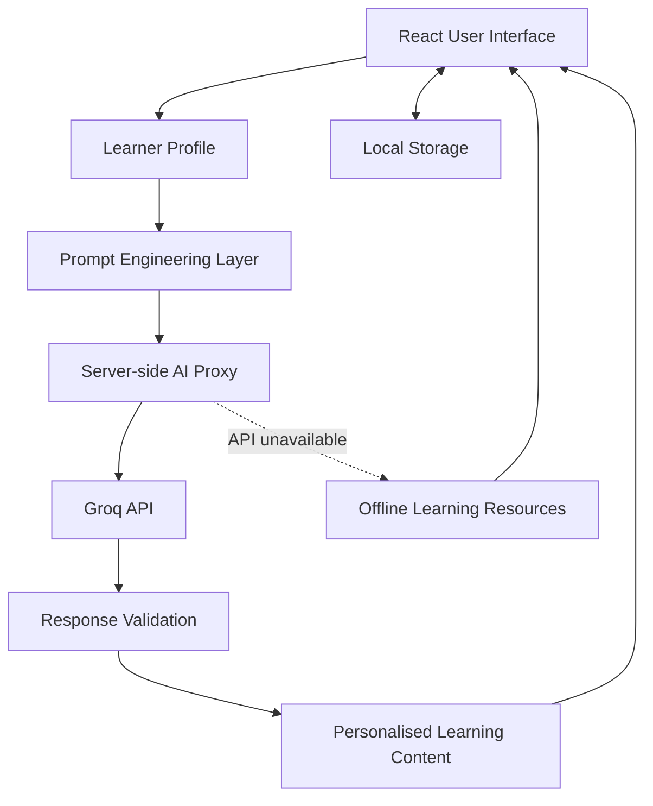

<div align="center">

# LangLearn

### Learn a new language. One conversation at a time.

An AI-powered multilingual learning platform that adapts to your language, proficiency, and learning goals.


[Features](#features) · [Getting Started](#getting-started) · [Architecture](#architecture) · [Prompt Engineering](#prompt-engineering)

</div>

---

## Overview

**LangLearn** is an intelligent language learning platform designed to make language education personalised, interactive, and accessible.

Powered by generative AI and prompt engineering, LangLearn adapts its responses to the learner's native language, target language, proficiency level, and learning objectives.

From everyday conversations to grammar correction and vocabulary practice, everything is available in a single, minimal interface.

## Features

### Learn

| Feature | Description |
| :--- | :--- |
| AI Tutor | Personalised lessons and interactive multilingual conversations |
| Vocabulary | Word meanings, pronunciation, and contextual examples |
| Grammar | Sentence correction with clear explanations |
| Translation | Context-aware translation between supported languages |

### Practice

| Feature | Description |
| :--- | :--- |
| Adaptive Quizzes | Assessments tailored to the learner's proficiency |
| Conversation Simulator | Real-world scenarios for practical language learning |
| Mistake Analysis | Identify recurring errors and learning weaknesses |
| Smart Revision | Spaced repetition and targeted revision |

### Platform

- Personalised learner profiles
- Multilingual learning support
- Persistent progress tracking
- Light and dark themes
- Responsive and minimal interface
- Offline learning resources
- Secure server-side AI integration

## Getting Started

### Prerequisites

- Node.js 20.19+ or 22.12+
- npm
- Groq API key

### 1. Clone the repository

```bash
git clone https://github.com/riyanshajoshi/LangLearn.git
cd LangLearn
```

### 2. Install dependencies

```bash
npm install
```

### 3. Configure the AI provider

Create a `.env` file in the project root using `.env.example` as a reference.

```env
AI_PROVIDER=groq
GROQ_API_KEY=your_api_key_here
GROQ_MODEL=qwen/qwen3.8-27b
```

Get your API key from the [Groq Console](https://console.groq.com/keys).

Use a model available to your Groq account.

> **Note:** Never commit your `.env` file or API credentials to GitHub.

### 4. Start the application

```bash
npm run dev
```

Visit **http://localhost:5173** to begin learning.

### Production Build

```bash
npm run build
```

Live AI functionality requires the server-side API proxy. Static hosting alone does not support AI requests.

## Architecture



## Prompt Engineering

LangLearn uses structured prompting techniques to generate consistent, personalised, and context-aware educational content.

| Technique | Application |
| :--- | :--- |
| Role Prompting | Establishes the AI as a professional language tutor |
| Few-Shot Prompting | Provides examples for consistent sentence correction |
| Contextual Prompting | Adapts responses to learner preferences |
| Output Formatting | Generates structured lessons and assessments |
| Adaptive Prompting | Adjusts difficulty according to proficiency |
| Prompt Evaluation | Tests and refines prompts through Prompt Lab |
| Output Validation | Checks AI responses before presentation |

## Technology Stack

| Layer | Technology |
| :--- | :--- |
| Frontend | React, JavaScript |
| Styling | CSS |
| Build Tool | Vite |
| Server | Node.js |
| AI Inference | Groq API |
| Data Persistence | Browser Local Storage |

## Project Structure

```text
LangLearn/
├── public/             # Static assets
├── server/             # Server-side AI integration
├── src/                # Application source code
│   ├── components/     # Reusable UI components
│   └── lib/            # AI utilities and learning logic
├── .env.example        # Environment configuration template
├── .gitignore
├── package.json
├── vite.config.js
└── README.md
```

## Reliability & Privacy

- API credentials are stored server-side.
- Learner preferences and progress are stored locally.
- Built-in resources provide limited offline functionality.
- AI responses depend on model availability and provider limits.
- Generated learning content may require verification.

## Future Enhancements

- Speech recognition and pronunciation assessment
- Expanded multilingual offline lessons
- Personalised learning roadmaps
- Cloud-based progress synchronisation
- Advanced learning analytics

---

<div align="center">

### LangLearn

*Breaking language barriers through intelligent learning.*

Developed as a Prompt Engineering academic project.

</div>
